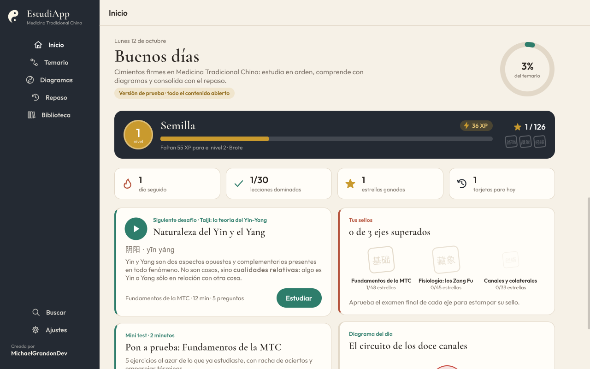
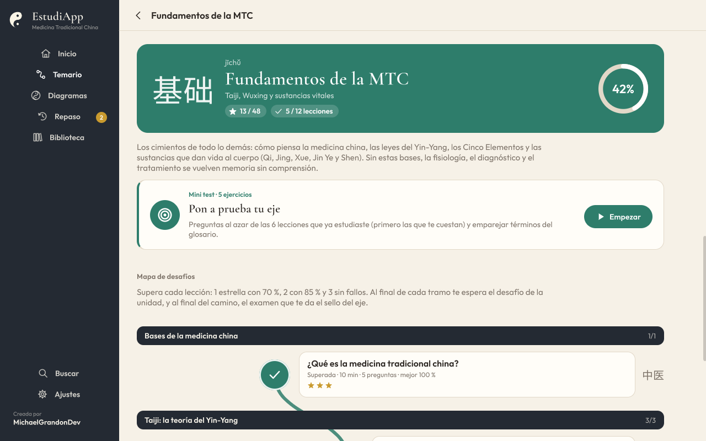
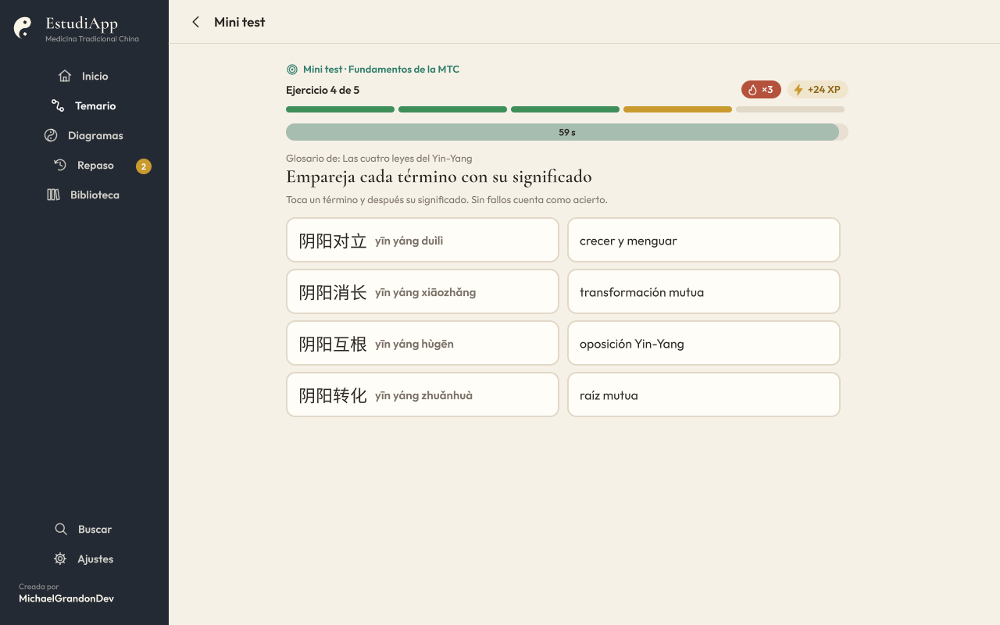
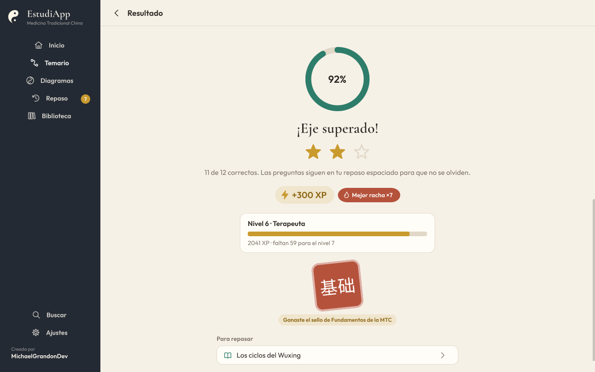
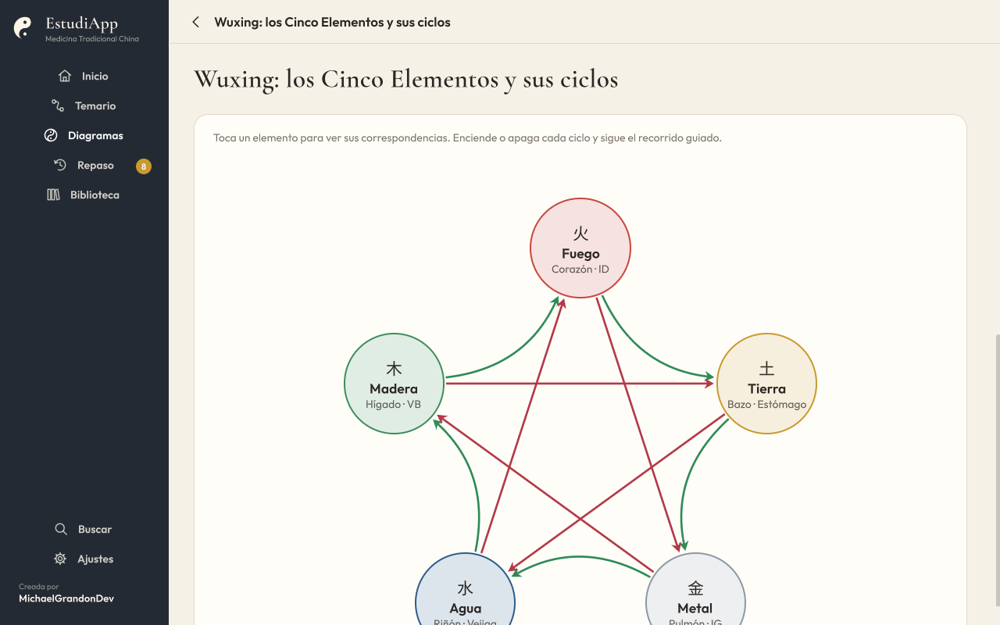
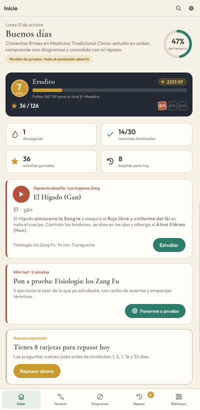

# EstudiApp MTC

[](https://unity.com/)
[](https://learn.microsoft.com/dotnet/csharp/)
[](#abrir-y-compilar)
[](#verificar)
[](#planes)
[](#licencia)

App de estudio de **Medicina Tradicional China** hecha con **Unity 6 (6000.6.5f1) y C#**, para macOS, Windows, Android e iOS. Propone una ruta de aprendizaje por ejes temáticos con lecciones, diagramas interactivos, desafíos con estrellas y sellos, mini tests y repaso espaciado, y enlaza cada cita con la página exacta de tus propios libros en PDF.

Creada por **[MichaelGrandonDev](https://github.com/MichaelGrandonDev)**.

## Capturas

| Inicio | Mapa de desafíos | Mini test: emparejar |
|---|---|---|
|  |  |  |
| **Examen del eje y sello** | **Diagrama Wuxing** | **Móvil** |
|  |  |  |

## Funcionalidades

- **Ruta de aprendizaje por ejes temáticos**: dentro de un eje, cada lección se abre al aprobar la anterior con un 70 %. Un eje nuevo se abre cuando dominas el 70 % de los ejes que necesita. El *modo libre* (en Ajustes) abre todo.
- **Lecciones** con idea central, texto, tablas, notas clínicas, puntos clave, glosario con hanzi y pinyin, citas con libro y página, y una evaluación al final.
- **Diagramas interactivos**: Wuxing con sus ciclos, Taiji y reloj de los órganos con la hora actual, balanza Yin-Yang con controles, Zang Fu, Sanjiao, formación del Qi, circulación de los canales, vasos extraordinarios… Se pueden tocar, tienen capas que se encienden y recorridos guiados.
- **Ruta de desafíos**: cada eje es un mapa con un nodo por lección, un desafío al final de cada unidad y un examen final que da el sello del eje. Estrellas, experiencia (XP), niveles y rachas de aciertos para ver cómo avanzas (ver [Desafíos y mini tests](#desafíos-y-mini-tests)).
- **Mini tests** por eje («Pon a prueba tu eje»): 5 ejercicios al azar de lo ya estudiado, con reloj opcional y un ejercicio de emparejar términos del glosario.
- **Repaso espaciado** (cajas Leitner: 1, 3, 7, 16 y 35 días) con las preguntas de las evaluaciones.
- **Biblioteca y lector PDF**: subes tus PDF, que se reconocen y enlazan solos con la bibliografía. Cada cita de una lección abre tu PDF en la página exacta. El lector tiene zoom, marcadores, búsqueda de texto y ajuste de desfase si tu edición numera distinto.
- **Búsqueda** en todo el temario (lecciones, glosario y diagramas).
- <a id="planes"></a>**Planes**: por ahora es una *versión de prueba* con todo abierto. El modelo gratuito/Premium ya está programado y se activa al compilar con `-plans`.

Los resúmenes están redactados con palabras propias a partir de Li Ping (*El gran libro de la medicina china*), Giovanni Maciocia (*Los fundamentos de la medicina china*), el *Su Wen*, Claudia Focks (*Atlas de acupuntura*) y los apuntes de la Escuela Neidan. Los libros **no** se incluyen en la app ni en este repositorio: cada estudiante sube los suyos.

## Tecnologías usadas

| Componente | Tecnología | Para qué |
|---|---|---|
| Motor | **Unity 6** (`6000.6.5f1`) | App multiplataforma con un único proyecto |
| Lenguaje | **C# 9.0** (el nivel de lenguaje que admite el compilador de Unity) | Toda la lógica y la interfaz |
| Interfaz | **UI Toolkit** construida en código (sin UXML) + hoja de estilos **USS** (`Theme.uss`) y `RuntimeTheme.tss` | Páginas, navegación lateral (escritorio) e inferior (móvil), tarjetas, tests |
| Gráficos vectoriales | **Painter2D** (`generateVisualContent`) | Diagramas interactivos (grafo, anillo/reloj, balanza, lengua) e iconos |
| Serialización | **Newtonsoft.Json** (`com.unity.nuget.newtonsoft-json` 3.2.2) | Temario compilado, progreso, ajustes y biblioteca en JSON |
| Arquitectura | **Assembly definitions**: `EstudiApp.Domain` (sin referencias al motor), `EstudiApp.Runtime`, `EstudiApp.Editor` | Separar la lógica pura (testeable con .NET) de Unity y de las herramientas de editor |
| Lector PDF | **PDFium** por **P/Invoke** (`PdfiumNative.cs`), binarios por plataforma en `Assets/Plugins/PDFium` y `pdfium.framework` | Renderizar páginas y extraer texto para buscar |
| Selector de PDF en Android | Plugin nativo **Java** (`EstudiAppPdf.androidlib`, Storage Access Framework) | Elegir un PDF con el selector de documentos del sistema |
| Selector de PDF en iOS | Plugin nativo **Objective-C++** (`EstudiAppPdf.mm`, `UIDocumentPicker`) | Elegir un PDF desde Archivos |
| Selector de PDF en escritorio | Diálogo del sistema: `osascript` (macOS), PowerShell + WinForms (Windows), `zenity` (Linux) | Importar PDF sin dependencias extra |
| Compilación móvil | **IL2CPP**, **ARM64**, Android API 26+, iOS 15+ | Builds nativos para Google Play / App Store |
| Escritorio | Standalone macOS y Windows (con atajo de compilación); binario de PDFium para Linux x86_64 incluido | Uso en ordenador |
| Pipeline de contenido | **Python 3**: `build_content.py` (markdown + JSON → `curriculum.json`, subconjunto de Noto Sans SC con `fontTools.subset`), `kb.py` (índice de los libros con **SQLite FTS5** y **pypdf**), `patch_fonts.py` (**fontTools**), `make_icon.py` (**Pillow**) | Redactar, validar y compilar el temario; generar fuentes e icono |
| Pruebas | **.NET 7** + **xUnit** (`Tools/DomainTests`) | Probar el dominio y validar el temario sin abrir Unity |
| Tipografías | **Outfit**, **Cormorant Garamond**, **Noto Sans SC** (SIL OFL) | Texto, títulos y caracteres chinos |
| Formato de contenido | **Markdown** con directivas propias + **JSON** | Ejes, lecciones, evaluaciones, bibliografía y diagramas |

Paquetes de Unity usados (ver `EstudiAppMTC/Packages/manifest.json`): `com.unity.nuget.newtonsoft-json`, `com.unity.ugui` y los módulos `androidjni`, `imageconversion`, `imgui`, `jsonserialize`, `ui`, `uielements` y `unitywebrequest`.

## Arquitectura y estructura

```
EstudiAppMTC/                     Proyecto Unity
  Assets/_Project/Scripts/
    Domain/                       Lógica pura (sin Unity): temario, progreso, desafíos, recompensas,
                                  repaso, planes, búsqueda y reconocimiento de libros
    Runtime/Core/                 Arranque, servicios, guardado JSON, biblioteca, selector de PDF
    Runtime/Pdf/                  PDFium por P/Invoke (renderizado y texto)
    Runtime/UI/                   Interfaz (UI Toolkit construida en código), páginas y diagramas
    Editor/                       Escena, ajustes del reproductor, plugins nativos y compilación
  Assets/_Project/Resources/UI/   Theme.uss, fuentes (Outfit, Cormorant Garamond, Noto Sans SC reducida)
  Assets/_Project/Branding/       Iconos de la app
  Assets/Plugins/                 PDFium por plataforma, selector de Android (.androidlib) e iOS (.mm)
  Assets/StreamingAssets/content/curriculum.json   Temario compilado
Tools/
  content/                        Fuente del temario (markdown + JSON) y su compilador
  knowledge/kb.py                 Índice de texto de los libros para redactar y citar páginas (no se distribuye)
  DomainTests/                    Pruebas xUnit del dominio y validación del temario
  branding/make_icon.py           Genera el icono de la app (Assets/_Project/Branding)
  vendor/                         Noto Sans SC completa (las descargas de PDFium no se versionan)
docs/screenshots/                 Capturas de este README
```

El dominio no depende de Unity (`noEngineReferences: true`), así que el mismo código se compila dentro de Unity y en el proyecto de pruebas de .NET.

## Abrir y compilar

1. Abre `EstudiAppMTC` con Unity Hub (6000.6.5f1, con los módulos de Android/iOS si vas a compilar para móvil).
2. Si es la primera vez, ejecuta **EstudiApp ▸ Configurar plugins nativos**. La escena `Assets/_Project/Scenes/Main.unity` ya está creada; si falta, usa **EstudiApp ▸ Crear escena principal**.
3. Pulsa Play, o compila desde **EstudiApp ▸ Compilar** (macOS, Windows, Android, iOS). Las salidas van a `EstudiAppMTC/Builds/`.

Desde la terminal:

```bash
UNITY="/Applications/Unity/Hub/Editor/6000.6.5f1/Unity.app/Contents/MacOS/Unity"
"$UNITY" -batchmode -quit -projectPath EstudiAppMTC -executeMethod EstudiApp.EditorTools.BuildScript.Mac -logFile build.log
# Otras: BuildScript.Windows, BuildScript.Android (añade -aab para Google Play), BuildScript.IOS
# Con planes gratuito/Premium: añade -plans
```

- **iOS**: genera el proyecto de Xcode en `Builds/iOS`. `pdfium.framework` se incrusta solo; hay que firmar con tu equipo en Xcode.
- **Android**: IL2CPP ARM64, API mínima 26. El selector de PDF usa el selector de documentos del sistema.

## Verificar

```bash
# Pruebas del dominio y validación del temario (68 pruebas)
cd Tools/DomainTests && dotnet test

# Recorrido automático de capturas de la app compilada (escritorio y móvil), con progreso simulado en memoria
# (no toca el tuyo): mapa de desafíos, mini test, resultado y examen con sello. Con -estudiapp-pdf también
# importa ese PDF, lo abre en el lector desde una cita y lo quita al terminar.
"EstudiAppMTC/Builds/macOS/EstudiApp MTC.app/Contents/MacOS/EstudiApp MTC" \
  -estudiapp-shots "$PWD/Tools/logs/shots" \
  -estudiapp-pdf "$HOME/Desktop/LIBROS MTC/Los Fundamentos de la Medicina China.pdf"
```

## Escribir contenido

El temario se escribe en `Tools/content/src` y se compila con:

```bash
python3 Tools/knowledge/kb.py build        # una vez: índice de los libros, para resolver páginas de PDF
python3 Tools/content/build_content.py     # genera curriculum.json y la fuente china reducida
python3 Tools/content/patch_fonts.py       # sólo si se reemplazan las fuentes Outfit (añade ǐ ǒ ǔ)
```

Dependencias de Python: `pypdf` (para `kb.py build`), `fontTools` (fuentes) y `Pillow` (icono).

Buscar en los libros mientras se redacta: `python3 Tools/knowledge/kb.py search jing prenatal --book liping,maciocia` y `python3 Tools/knowledge/kb.py show maciocia 27`.

### Ejes (`src/axes/NN-nombre.md`)

```markdown
@axis canales
title: Canales y colaterales
hanzi: 经络
pinyin: jīngluò
subtitle: Jing Luo, reloj horario y puntos
color: #3D6FA6
level: 2
premium: no
requires: fisiologia
description: Para qué sirve este eje.

@unit sistema | El sistema de canales

@lesson can-reloj
title: El reloj de los órganos
hanzi: 子午流注
pinyin: zǐwǔ liúzhù
minutes: 12
diagrams: reloj-organos
summary: Idea central en una o dos frases.

## Título de sección
Párrafo con **negrita** y *cursiva*.

- Lista
| Tabla | con encabezado |
|---|---|
| fila | fila |
> Cita textual breve | suwen:cap5
!nota Recuadro de nota.
!clinica Recuadro «En la clínica».
::diagrama reloj-organos

### Puntos clave
- Punto

### Términos
- 经络 | jīngluò | canales y colaterales | Definición.

### Referencias
- maciocia:19-21 | nota opcional
- suwen:cap5
- liping:@34            (página de PDF explícita)

### Evaluación
? Pregunta
- [x] Correcta
- [ ] Incorrecta
= Explicación que se muestra al responder.
```

Una pregunta con varias `[x]` es de opción múltiple; con las opciones «Verdadero / Falso» es de verdadero o falso. Las páginas impresas se convierten en página de PDF con el índice de `kb.py`. Los ids de libro están en `src/books.json`.

### Diagramas (`src/diagrams/NN-nombre.json`)

Lista de diagramas con `id`, `title`, `kind`, `intro`, `aspect` (alto/ancho) y `references`. Según el tipo:

- `graph`: `nodes` (`id`, `label`, `hanzi`, `sub`, `x`, `y` relativos, `shape` circle/rect, `size`, `color`, `detail`, `ref`, `layer`), `edges` (`from`, `to`, `layer`, `label`, `bend`, `dashed`, `both`, `color`, `detail`), `layers`, `steps` (`title`, `text`, `focus`, `layers`) y `layout` circular opcional.
- `ring`: `segments` (`id`, `label`, `hanzi`, `sub`, `color`, `detail`, `hour`), `center: "taiji"`, `showClock`, `startHour`.
- `balance`: `states` con los ids que devuelve `YinYangBalance.Classify` (`equilibrio`, `exceso_yang`, `vacio_yin`, …).
- `tongue`: `zones` con ids `raiz`, `centro`, `lado-izq`, `lado-der`, `pulmon`, `punta`.

Las pruebas de `Tools/DomainTests` comprueban que todo lo que se referencia existe: libros, diagramas, nodos, capas y respuestas.

## Desafíos y mini tests

La lógica está en `Domain/Services/ChallengeService.cs` y `Rewards.cs`; no cambia las reglas de desbloqueo (lección siguiente con 70 %, eje nuevo con el 70 % de sus requisitos, modo libre abre todo).

- **Etapas de un eje**: las lecciones de cada unidad, el **desafío de la unidad** (8 preguntas repartidas entre sus lecciones; sólo en unidades de 2 lecciones o más; se abre al dominarlas todas) y el **examen del eje** (12 preguntas de todo el eje; se abre al dominar todas las lecciones y superar los desafíos de unidad). Aprobar el examen da el **sello** del eje.
- **Estrellas**: 1 con 70 %, 2 con 85 %, 3 sin fallos (sobre la mejor nota).
- **Experiencia**: 5 XP por acierto (+2 con reloj), +3 por cada acierto seguido desde el tercero, +20 sin fallos, +15 por estrella nueva, y la primera vez +30 por lección, +80 por desafío de unidad y +200 por examen de eje. El repaso da 2 XP por tarjeta acertada. Niveles: 0, 100, 300, 600, 1000… XP (Semilla, Brote, Aprendiz, Estudiante…).
- **Mini test** («Pon a prueba tu eje»): 5 ejercicios de las lecciones leídas o evaluadas del eje, con prioridad a lo fallado o sin repasar, más un ejercicio de emparejar hanzi/pinyin con su significado (del glosario de una lección con 4 términos o más). Se puede repetir siempre.
- Las preguntas de los desafíos alimentan el repaso espaciado: las nuevas crean tarjeta y las falladas vuelven a la primera caja para hoy.
- La selección de preguntas recibe un `System.Random` (misma semilla, mismo test). El progreso antiguo (`Version` 1) se migra al cargarlo: se acredita la experiencia de las lecciones ya dominadas.

## Datos del estudiante

Se guardan en `Application.persistentDataPath`: `progress.json`, `settings.json`, `library.json` y la carpeta `library/` con los PDF importados. No hay servidor ni cuentas: todo queda en el dispositivo.

## Aviso

EstudiApp MTC es una **herramienta de estudio**. No sustituye la formación reglada ni el criterio de un profesional sanitario, y no debe usarse para diagnosticar ni tratar.

## Derechos de autor del contenido

- Los libros de referencia **no** forman parte del repositorio ni de la app; cada estudiante importa sus propios PDF.
- Los resúmenes del temario están redactados con palabras propias; sólo se incluyen citas textuales breves con su referencia.
- El índice de texto de los libros (`Tools/knowledge/cache/`), los registros y las capturas del lector (`Tools/logs/`) se generan en local y están excluidos con `.gitignore`.

## Licencia

Pendiente de decisión del autor. Mientras no se añada un archivo `LICENSE`, todos los derechos sobre el código y el contenido propio quedan reservados.

## Licencias de terceros

PDFium (BSD/Apache 2.0, ver `Assets/Plugins/PDFium/LICENSE-pdfium.txt`), Outfit, Cormorant Garamond y Noto Sans SC (SIL Open Font License; a Outfit se le añadieron las vocales del pinyin con carón), y Newtonsoft.Json (MIT).
